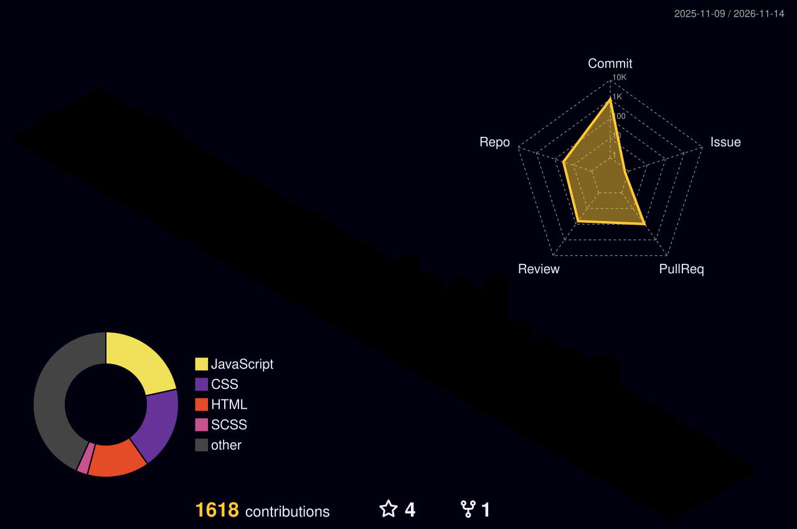

<!-- Header -->

  <!-- Dynamic capsule render for header banner -->
  

   

  
  

 

## 👤 About Me

디자인 시안의 디테일을 왜곡 없이 옮기는 **프론트엔드 개발자 xoxo**입니다.

- 🎯 **픽셀 단위 구현** — Figma 시안을 React 19 · Next.js · TypeScript · Tailwind v4 · SCSS로 그대로 살립니다.
- ✨ **인터랙션 설계** — GSAP ScrollTrigger와 3D 변환으로 스크롤에 반응하는 움직임을 직접 만듭니다.
- 🧱 **배포까지 완성** — Supabase · Edge Functions로 인증·데이터·AI 연동을 붙여 실제 서비스로 마무리합니다.
- 🎓 이스트소프트 오르미 프론트엔드 13기 수료 (2026.04 ~ 08)

---

## ⭐ Featured Projects

채용 담당자분이 5초 안에 실력을 확인할 수 있도록, 대표 작업 4개만 위에 올렸습니다.

 

### 🍳 1. 깃깔나는 레시피 — 생성형 AI 맞춤 레시피 &amp; 스마트 쿠킹 플랫폼

ESTsoft 오르미 프론트엔드 13기 최종 팀 프로젝트 · 4인 팀 · 2026.07 ~ 08

  
  
  
  
  

사용자의 남은 재료와 조건에 맞춰 AI가 레시피와 이미지를 만들어 주고, 장보기·조리·후기까지 이어지는 올인원 쿠킹 서비스입니다.

- **팀 커밋 1위 (117개)** — 메인 홈 7개 섹션의 모듈화 아키텍처와 공통 컴포넌트를 설계했습니다.
- **AI 비전 연동** — OpenAI Vision으로 냉장고 사진 속 식재료를 인식해 맞춤 레시피로 연결했습니다.
- **스마트 장보기** — 레시피 재료를 마트 5대 코너로 자동 분류하고, 장보기 완료 시 AI 냉장고로 자동 입고되는 파이프라인을 구현했습니다.

  
  

 

### 🕶️ 2. ROUNZ 반응형 리뉴얼 — 안경 · 선글라스 쇼핑몰

ESTsoft 오르미 프론트엔드 13기 2차 팀 프로젝트 · 5인 팀 · 2026.05 ~ 06 · Vanilla JS / SCSS

  
  
  
  

프레임워크 없이 HSL 기반 디자인 토큰과 ES Modules만으로 데스크톱 · 태블릿 · 모바일을 모두 대응하는 반응형 쇼핑몰을 다시 만들었습니다.

- **팀 커밋 1위 (187개)** — 기획·디자인부터 메인 · 푸터 · 상품비교 페이지 퍼블리싱까지 담당했습니다.
- **컴포넌트 단위 모듈화** — 슬라이더, 캐러셀, 지점 검색 필터, 아코디언을 독립 파일로 분리해 결합도를 낮췄습니다.
- **실제 페이지로 확인** — GitHub Pages 데모에서 바로 볼 수 있습니다.

  
  

 

### 📖 3. Slow Page — 월간 도서 구독 · 북 큐레이션

GSAP ScrollTrigger · CSS 3D 북 플립 · 반응형 퍼블리싱

  
  
  

책을 넘기는 감각을 웹으로 옮긴 도서 큐레이션 사이트입니다. 뉴스, 책 속 밑줄, 베스트 추천, 슬로우 페이지 랭킹, 커뮤니티 섹션으로 구성했습니다.

- **가로 스크롤 서사** — GSAP ScrollTrigger로 스크롤 위치마다 장면이 이어지도록 설계했습니다.
- **3D 북 플립** — CSS 3D 변환으로 표지를 직접 넘기는 인터랙션을 구현했습니다.
- **퍼블리싱 완결** — 디자인 시안을 그대로 옮긴 반응형 레이아웃으로 배포했습니다.

  
  

 

### 🏎️ 4. PORSCHE · Ferrari — 고정밀 인터랙티브 클론

디자인 시안을 픽셀 단위로 옮기는 디테일 역량 증명 · Private Repo

  
  

브랜드 공식 사이트의 레이아웃 · 타이포그래피 · 전환 애니메이션을 시안과 같은 밀도로 재현한 클론 프로젝트입니다.

- **PORSCHE** — 포르쉐코리아 공식 사이트를 PDS 디자인 시스템과 Astro를 함께 쓰는 구조로 재구현했습니다.
- **Ferrari** — 페라리 공식 사이트의 고해상도 비주얼과 스크롤 인터랙션을 React 19 · Vite로 재현했습니다.
- **디테일 대조** — 브레이크포인트별 간격과 폰트, 모션 타이밍 차이를 줄이는 데 집중했습니다.

 

> 위 4개 외에 53개 프로젝트를 아래 아카이브에 접어 두었습니다 — 브랜드 클론 22개 · 부트캠프 3개 · React 실습 18개 · 샌드박스 10개.

---

## 📂 More Projects & Archive

브랜드 클론부터 React 실습, 샌드박스까지 — 작업 단위로 접어 두었습니다. 펼쳐서 보세요.

  
💻 <b>Web Clones &amp; Interactive Sites</b> (22)

   

  <table border="0">
    <tr>
        <td align="center" valign="top" width="50%">
          
           
          한국 코카-콜라 공식 브랜드 웹사이트 트렌디 레이아웃 클론 코딩
           
          🔒 Private
        </td>
        <td align="center" valign="top" width="50%">
          
           
          삼성물산 공식 웹사이트 반응형 네비게이션 및 스크롤 인터랙션 클론
           
          🔒 Private
        </td>
    </tr>
    <tr>
        <td align="center" valign="top" width="50%">
          
           
          BMW 코리아 공식 홈페이지 메가 메뉴 &amp; 고해상도 그리드 클론 코딩
           
          🔒 Private
        </td>
        <td align="center" valign="top" width="50%">
          
           
          애플 코리아 공식 홈페이지 프리미엄 레이아웃 &amp; 네비게이션 클론
           
          🔒 Private
        </td>
    </tr>
    <tr>
        <td align="center" valign="top" width="50%">
          
           
          스타벅스 코리아 공식 웹사이트 시즌 테마 &amp; 메뉴 슬라이더 클론
           
          🔒 Private
        </td>
        <td align="center" valign="top" width="50%">
          
           
          현대카드 공식 웹사이트 고정밀 클론 (Express 혜택 API &amp; 인터랙티브 카드 시뮬레이션)
           
          🔒 Private
        </td>
    </tr>
    <tr>
        <td align="center" valign="top" width="50%">
          
           
          신한카드 메인 페이지 고해상도 클론 (Vercel POST 제한 우회 Mock Data 파이프라인)
           
          🔒 Private
        </td>
        <td align="center" valign="top" width="50%">
          
           
          포켓몬 코리아 공식 웹사이트 고해상도 리플리카 (Live API 프록시 백엔드 미들웨어)
           
          🔒 Private
        </td>
    </tr>
    <tr>
        <td align="center" valign="top" width="50%">
          
           
          카카오맵 클론 코딩 (Rust Wasm Dijkstra 경로 최단 연산 고도화)
           
          🔒 Private
        </td>
        <td align="center" valign="top" width="50%">
          
           
          KFC 딜리버리 및 메뉴 주문 레이아웃 픽셀 단위 정밀 클론 코딩
           
          🔒 Private
        </td>
    </tr>
    <tr>
        <td align="center" valign="top" width="50%">
          
           
          토스 메인 &amp; 금융 상품 소개 페이지 클론 코딩
           
          🔒 Private 
        </td>
        <td align="center" valign="top" width="50%">
          
           
          더뮤즈엔터테인먼트 공식 웹사이트 고해상도 클론 코딩
           
          🔒 Private 
        </td>
    </tr>
    <tr>
        <td align="center" valign="top" width="50%">
          
           
          비프의 푸른 바다 모험 - AI 인터랙티브 동화책
           
          🔒 Private 
        </td>
        <td align="center" valign="top" width="50%">
          
           
          Static Landing Page &amp; Corporate Design
           
          🔓 Public 
        </td>
    </tr>
    <tr>
        <td align="center" valign="top" width="50%">
          
           
          현대자동차그룹 메인 추천 기능 클론 코딩
           
          🔒 Private
        </td>
        <td align="center" valign="top" width="50%">
          
           
          신세계백화점 공식 홈페이지 메인 페이지 고해상도 클론 코딩 (VIP 로그인 시뮬레이션)
           
          🔒 Private
        </td>
    </tr>
    <tr>
        <td align="center" valign="top" width="50%">
          
           
          현대백화점 공식 포털 사이트 정밀 클론 코딩 (Happiness-Sans 폰트 &amp; API 미들웨어)
           
          🔒 Private
        </td>
        <td align="center" valign="top" width="50%">
          
           
          리센느(RESCENE) 팬메이드 아카이브 웹 애플리케이션 (극장식 모달 플레이어 &amp; PWA)
           
          🔒 Private
        </td>
    </tr>
    <tr>
        <td align="center" valign="top" width="50%">
          
           
          React 19과 TS 기반 스포티파이 웹 플레이어 클론 코딩 (가사 동기화 &amp; 동적 테마)
           
          🔒 Private
        </td>
        <td align="center" valign="top" width="50%">
          
           
          카카오뱅크 공식 홈페이지 메인 페이지 클론 코딩 (스크롤 감지 &amp; Swiper)
           
          🔒 Private
        </td>
    </tr>
    <tr>
        <td align="center" valign="top" width="50%">
          
           
          스타필드 하남 공식 홈페이지 반응형 클론 코딩 (메가 메뉴 &amp; Swiper 3D 카드)
           
          🔒 Private
        </td>
        <td align="center" valign="top" width="50%">
          
           
          SBS 아카데미 컴퓨터아트학원 안산점 풀스택 실무 애플리케이션 (React + FastAPI)
           
          🔒 Private
        </td>
    </tr>
  </table>

  
🎓 <b>ESTsoft Frontend Bootcamp (FE 13)</b> (3)

   

  <table border="0">
    <tr>
        <td align="center" valign="top" width="50%">
          
           
          1st Team Project - EST CAMP (Public Mirror)
           
          🔓 Public 
        </td>
        <td align="center" valign="top" width="50%">
          
           
          Bootcamp News App Project
           
          🔒 Private
        </td>
    </tr>
    <tr>
        <td align="center" valign="top" width="50%">
          
           
          Shopping Cart Practice
           
          🔓 Public 
        </td>
    </tr>
  </table>

  
🧪 <b>React &amp; API Labs</b> (18)

   

  <table border="0">
    <tr>
        <td align="center" valign="top" width="50%">
          
           
          React 19 &amp; Oxlint Linter Review Mission 8
           
          🔓 Public 
        </td>
        <td align="center" valign="top" width="50%">
          
           
          React Basic Review Mission 7
           
          🔓 Public 
        </td>
    </tr>
    <tr>
        <td align="center" valign="top" width="50%">
          
           
          React Basic Mission 5
           
          🔓 Public 
        </td>
        <td align="center" valign="top" width="50%">
          
           
          React Basic Mission 3
           
          🔓 Public 
        </td>
    </tr>
    <tr>
        <td align="center" valign="top" width="50%">
          
           
          React Basic Mission 2
           
          🔓 Public 
        </td>
        <td align="center" valign="top" width="50%">
          
           
          React Template Mission
           
          🔓 Public 
        </td>
    </tr>
    <tr>
        <td align="center" valign="top" width="50%">
          
           
          Kakao Map API Practice
           
          🔓 Public 
        </td>
        <td align="center" valign="top" width="50%">
          
           
          Weather API Practice
           
          🔓 Public
        </td>
    </tr>
    <tr>
        <td align="center" valign="top" width="50%">
          
           
          React Hooks Study Starter Template
           
          🔓 Public
        </td>
        <td align="center" valign="top" width="50%">
          
           
          React useState hook state management
           
          🔓 Public
        </td>
    </tr>
    <tr>
        <td align="center" valign="top" width="50%">
          
           
          React Class Component Lifecycle &amp; useEffect Hook
           
          🔓 Public
        </td>
        <td align="center" valign="top" width="50%">
          
           
          React Context API global state management
           
          🔓 Public
        </td>
    </tr>
    <tr>
        <td align="center" valign="top" width="50%">
          
           
          React AJAX data fetching with axios &amp; fetch API
           
          🔓 Public
        </td>
        <td align="center" valign="top" width="50%">
          
           
          Todo List application with LocalStorage persistence
           
          🔓 Public
        </td>
    </tr>
    <tr>
        <td align="center" valign="top" width="50%">
          
           
          React Router navigation &amp; page transitions
           
          🔓 Public
        </td>
        <td align="center" valign="top" width="50%">
          
           
          Redux and global state management
           
          🔓 Public
        </td>
    </tr>
    <tr>
        <td align="center" valign="top" width="50%">
          
           
          Swiper library integration in React
           
          🔓 Public
        </td>
        <td align="center" valign="top" width="50%">
          
           
          React 19 컴포넌트, State &amp; 이벤트 기초 실습
           
          🔓 Public 
        </td>
    </tr>
  </table>

  
📂 <b>Portfolio Sandbox &amp; Lab</b> (10)

   

  <table border="0">
    <tr>
        <td align="center" valign="top" width="50%">
          
           
          Squarespace Foundations 템플릿 모듈 아키텍처 리팩토링
           
          🔒 Private
        </td>
        <td align="center" valign="top" width="50%">
          
           
          React 19 + Tailwind v4 3대 브랜드(ESSENCE LAB, ROM&amp;ND, SERENIQ) 포트폴리오
           
          🔒 Private
        </td>
    </tr>
    <tr>
        <td align="center" valign="top" width="50%">
          
           
          Next.js &amp; Supabase Portfolio
           
          🔓 Public 
        </td>
        <td align="center" valign="top" width="50%">
          
           
          Vite React Portfolio
           
          🔓 Public 
        </td>
    </tr>
    <tr>
        <td align="center" valign="top" width="50%">
          
           
          HTML/CSS Practice
           
          🔓 Public
        </td>
        <td align="center" valign="top" width="50%">
          
           
          Daily Coding Archive
           
          🔓 Public
        </td>
    </tr>
    <tr>
        <td align="center" valign="top" width="50%">
          
           
          Git Learning Workflow
           
          🔓 Public
        </td>
        <td align="center" valign="top" width="50%">
          
           
          Git Init Check
           
          🔓 Public
        </td>
    </tr>
    <tr>
        <td align="center" valign="top" width="50%">
          
           
          Self-hosted GitHub Readme Stats API on Vercel
           
          🔓 Public
        </td>
        <td align="center" valign="top" width="50%">
          
           
          GitHub Pull Shark Badge Archive
           
          🔓 Public
        </td>
    </tr>
  </table>

---

## 🛠️ Tech Stack

  
  
  
  
  
  
  

핵심 스택입니다. 그 외 스택은 아래에서 펼쳐 볼 수 있습니다.

  
🛠️ 전체 기술 스택 보기

   

### 🌐 Core Frontend & Frameworks

  
  
  
  
  
  
  
  
  
  

### 🎨 Styling, UI Systems & Components

  
  
  
  
  
  
  
  
  

### ⚡ State & Routing & Data Fetching

  
  
  

### 🎬 Animation & Visual Graphics

  
  
  
  
  

### 🗄️ Backend, Database & Cloud

  
  
  
  
  
  
  
  
  
  
  
  

### 🛡️ Code Quality, Testing & Dev Automation

  
  
  
  
  
  
  
  

### 🎨 Design & AI Coding Tools

  
  
  
  
  
  
  
  
  
  
  

---

## 📊 Activity & GitHub Insights

### ⚡ Recent Activity

<!-- START_SECTION:activity -->

- 🔀 [**xoxoworld**](https://github.com/xoxoworld/xoxoworld)에 PR [#7](https://github.com/xoxoworld/xoxoworld/pull/7) 오픈 (2026년 11월 10일)

<!-- END_SECTION:activity -->

 

  <table border="0">
    <tr>
      <td align="center">
        
      </td>
      <td align="center">
        
      </td>
    </tr>
    <tr>
      <td align="center" colspan="2">
        
      </td>
    </tr>
  </table>

   

  <!-- 3D Contribution Graph -->
  

---

## 📬 Contact

새로운 기회나 협업 제안은 언제든 메일로 보내 주세요.

  
  

<!-- Last updated: 2026-11-11 -->
